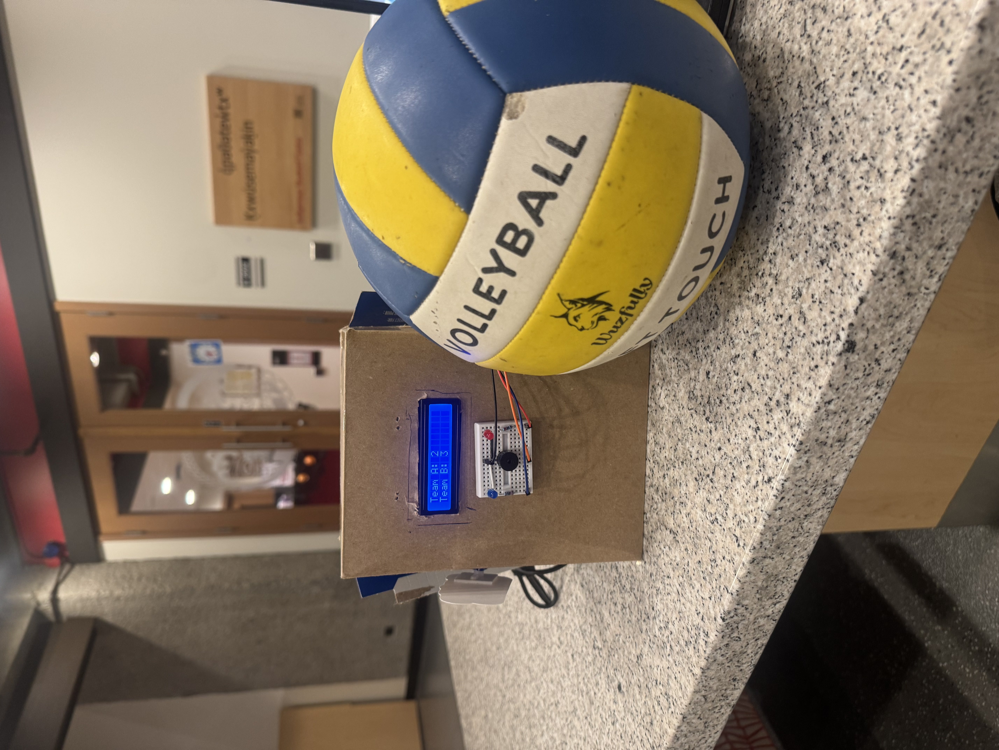
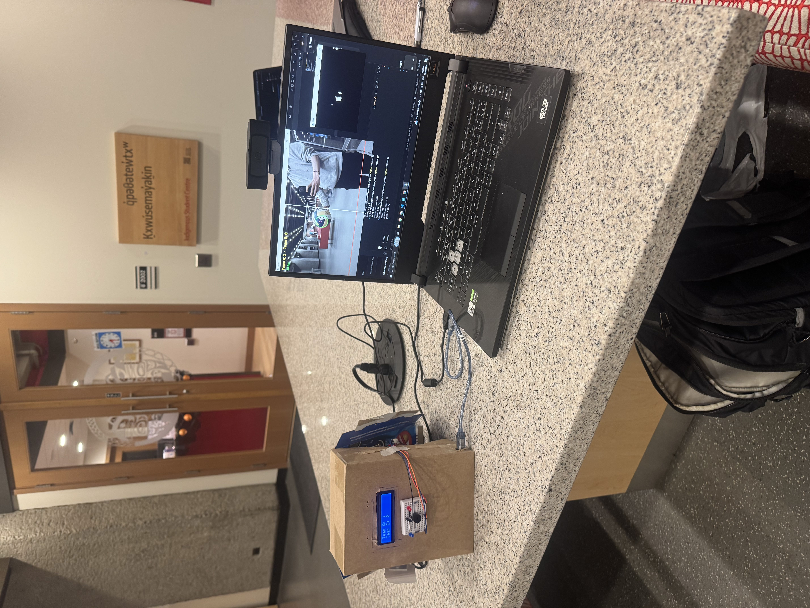
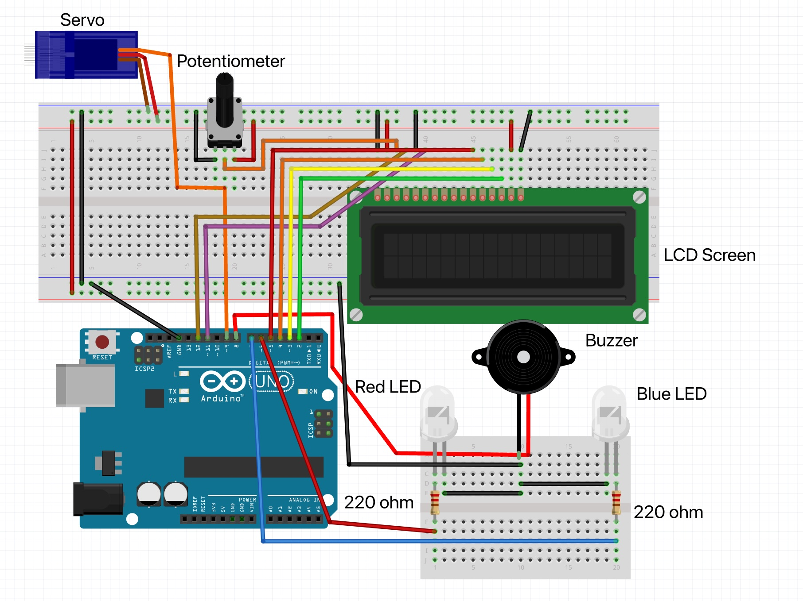
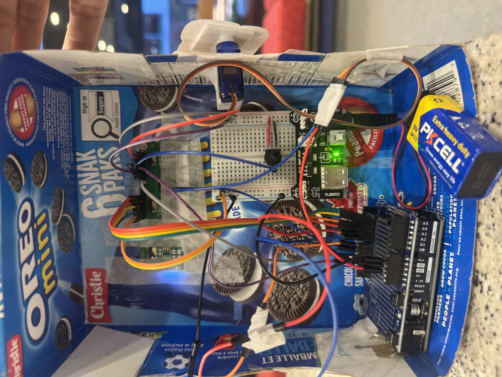

# SET: Score Event Tracker

A webcam watches a volleyball, detects when it hits the floor, and awards the point to the team on the other side of the net. An Arduino scoreboard reacts instantly: LCD score, red/blue LED, buzzer, and a servo flag.

Built at Protohacks 2026. No machine learning: HSV color tracking with OpenCV.

## Demo
| Enclosure | Tracker window |
|---|---|
|  |  |

## How it works
1. **Vision (Python + OpenCV):** Masks the ball's yellow and blue panels, merges them, finds the largest blob, and checks it against a calibrated floor line and net line.
2. **Scoring:** The ball touching the floor for a couple of frames counts as a point. The side of the net decides the team. A rearm margin and cooldown prevent double counts.
3. **Link:** Python sends `S,<scoreA>,<scoreB>,<team>` over USB serial (115200 baud). `R` resets the score.
4. **Arduino UNO:** Updates the LCD1602, lights the red (Team A) or blue (Team B) LED, beeps the buzzer, and raises the servo flag for 2 seconds.

## Hardware
Arduino UNO R3, SG90 servo, 16x2 LCD1602 (16-pin parallel) with 10k contrast pot, red and blue LEDs with 220 ohm resistors, buzzer, breadboard power module, Logitech webcam, laptop.

### Wiring diagram

  

### Actual wiring

  

| Part | Arduino pin |
|---|---|
| LCD RS / E | D12 / D11 |
| LCD D4 / D5 / D6 / D7 | D5 / D4 / D3 / D2 |
| Red LED | D6 |
| Blue LED | D7 |
| Buzzer + | D8 |
| Servo signal | D9 |

LCD power: VSS, RW, and K to GND; VDD and A to 5V; V0 to the middle of the contrast pot. All grounds are shared.

## Run it
1. Upload `set_scoreboard.ino` with the Arduino IDE (board: Arduino Uno). If the IDE asks to put it in a folder named `set_scoreboard`, click OK. Close the Serial Monitor afterward.
2. `pip install -r requirements.txt`
3. In `tracker.py`, tune the HSV ranges for your ball and set `USE_SERIAL = True`.
4. `python tracker.py`
5. Keys: `a`/`d` move the net line, `w`/`s` move the floor line, `r` resets the score, `q` quits.

## Tuning tips
- Calibrate with the Mask window; the ball should be one solid white blob.
- Bright, even light helps a lot, since webcams drop frame rate in dim rooms.
- Keep the camera level, with the floor near the bottom of the frame.

## What's next
60 fps camera, out-of-bounds lines, rally and serve detection, other balls, web dashboard.

## AI use
Code was written and debugged with help of an AI assistant (Claude). Hardware assembly, tuning, and testing were done by the author.
